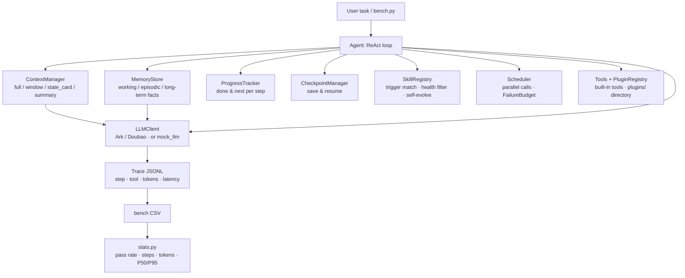

# agent-runtime-lab

A general-purpose task agent runtime with built-in evaluation and ablation experiments: pluggable Skills, three-layer memory, context budget compression, and an observable scheduler with failure attribution.

[中文 README](README_zh.md)

## What it does

This project builds an agent runtime from scratch (no framework, pure Python stdlib) and answers three engineering questions with reproducible numbers:

1. How much can context be compressed before critical constraints are lost?
2. On which tasks does three-layer memory actually help, and where is it pure overhead?
3. As the Skill library grows, how much do on-demand loading and self-evolution each contribute?

Every claim is backed by run traces in `logs/`. No hand-waving.

## Key results

| Module | Finding | Evidence |
|---|---|---|
| **Context compression** | `state_card` cuts input tokens by **34%** with zero success-rate drop, only +18% latency | `docs/experiments/001-context-compression.md` |
| **Three-layer memory** | With long-term memory: **4/4** tasks pass in 2.5 steps; without: **0/2** exhaust 8 steps | `docs/experiments/002-memory.md` |
| **Scheduler** | Parallel tool calls verified; `FailureBudget` stops repeated failed calls after 2 repeats | `docs/experiments/003-scheduler.md` |
| **Skills** | Manifest-based playbooks injected by trigger match; `learn_skill` self-evolves new skills to disk | `docs/experiments/004-skills.md` |
| **Progress tracking** | Per-step progress state injected into system prompt (inspired by ByteDance Aime's Progress Management) | `docs/experiments/005-advanced.md` |
| **Checkpoint / resume** | Save agent state mid-task, resume from breakpoint with `--resume` | `docs/experiments/005-advanced.md` |
| **Skill health** | Auto-disable skills whose success rate drops below threshold after ≥3 samples | `docs/experiments/005-advanced.md` |
| **Vector memory** | Character n-gram + cosine similarity retrieves the most relevant facts (not just latest N) | `docs/experiments/005-advanced.md` |
| **Plugin registry** | Drop `plugins/<name>/plugin.json` + `plugin.py` into the repo and the tool is callable by the loop (e.g. `word_count`) | `runtime/plugins.py`, `plugins/word_count/` |
| **Efficiency** | 29 real-model runs: 5510 tokens/task, P50 10.0 s, P95 19.0 s; `summary` strategy 167 s P50 | `stats.py`, `docs/experiments/006-efficiency.md` |

## Architecture



```
run_task.py / bench.py
        │
        ▼
   Agent (ReAct loop)
        │
        ├── ContextManager   → full / window / state_card / summary
        ├── MemoryStore      → L1 working / L2 episodic / L3 long-term facts (vector retrieval)
        ├── ProgressTracker  → per-step "done / next" state (Aime-style)
        ├── CheckpointManager→ save / resume task state
        ├── SkillRegistry    → match by triggers, inject playbook, health-based filter, self-evolve
        ├── Scheduler        → execute_parallel + FailureBudget
        ├── PluginRegistry   → drop a folder into plugins/ to add a new tool
        └── Tools            → read_file / write_file / list_files / run_python / http_get / remember / learn_skill
```

## Efficiency metrics

`stats.py` aggregates every `logs/bench_*.csv` into pass rate, average steps, token cost and P50/P95 latency (Mock runs are excluded from token/latency percentiles):

```powershell
D:\Trae-CN\tools\python\python.exe stats.py --markdown
D:\Trae-CN\tools\python\python.exe stats.py --markdown --price-in 0.8 --price-out 2.0   # 元 / 百万 tokens
```

Measured on real-model runs (29 samples, `full` strategy): average **5510 tokens/task**, **P50 10.0 s**, **P95 19.0 s**; `summary` strategy rises to **P50 167 s** — consistent with the 14× overhead seen in the ablation.

## Tech survey

Why build a minimal runtime instead of adopting a framework, and what would be adopted for production: see [`docs/tech-survey.md`](docs/tech-survey.md) (LangGraph / OpenAI Agents SDK / Agent Skills comparison).

## Quick start

```powershell
# 1. Paste API key & model ID (writes .env automatically)
D:\Trae-CN\tools\python\python.exe scripts\set_key.py

# 2. Connectivity self-check
D:\Trae-CN\tools\python\python.exe scripts\smoke_ark.py

# 3. Run a single task
D:\Trae-CN\tools\python\python.exe run_task.py evals\tasks\task_001.json

# 3b. Resume from a checkpoint (if a previous run was interrupted)
D:\Trae-CN\tools\python\python.exe run_task.py evals\tasks\task_001.json --resume

# 4. Run full benchmark (19 tasks)
D:\Trae-CN\tools\python\python.exe bench.py --reset-memory
```

Python is a portable install at `D:\Trae-CN\tools\python\python.exe`; no system PATH dependency.

## Zero-cost regression

All 19 tasks support `--mock` mode, which uses scripted responses instead of calling the real LLM — full pipeline coverage with **0 API tokens**:

```powershell
D:\Trae-CN\tools\python\python.exe bench.py --mock --reset-memory
# → 19/19 passed, 0 tokens, 0.4s
```

Use this for every code change; reserve real API calls for effect experiments only.

## Project structure

```
runtime/
  agent.py        ReAct main loop (action / actions / finish)
  context.py      4 context assembly strategies
  memory.py       three-layer memory + vector retrieval (char n-gram cosine)
  progress.py     per-step progress state (Aime-style Progress Management)
  checkpoint.py   save / resume task state
  scheduler.py    parallel execution + FailureBudget
  skills.py       Skill manifest loader, registry, health stats, self-evolution
  plugins.py      plugin registry (plugins/<name>/plugin.json + plugin.py)
  tools.py        7 built-in tools + plugins, paths sandboxed to workspace/
  llm.py          Volcano Ark (Doubao) OpenAI-compatible client
  mock_llm.py     scripted mock LLM for zero-quota regression
  trace.py        per-step JSONL trace logger
evals/tasks/      19 auto-gradable tasks
skills/           skill manifests (each a subdir with manifest.json)
plugins/          tool plugins (drop a folder to add a tool)
logs/             run traces (the only trusted data source)
docs/experiments/ experiment records with raw numbers
docs/tech-survey.md  framework comparison and build-vs-adopt decision
stats.py          pass rate / steps / tokens / P50-P95 from bench CSVs
.github/workflows/mock-bench.yml   CI: mock regression on every push
```

## Status

- [x] P0: ReAct loop + 7 tools + trace logging + 16 tasks + baseline
- [x] P1: Context compression (4 strategies), three-layer memory, scheduler (parallel + failure budget)
- [x] P2: Skill system (manifest + hot-plug + self-evolution via `learn_skill`)
- [x] P3a: English README, blog post, resume bullets, demo script
- [ ] P3b: Web console
